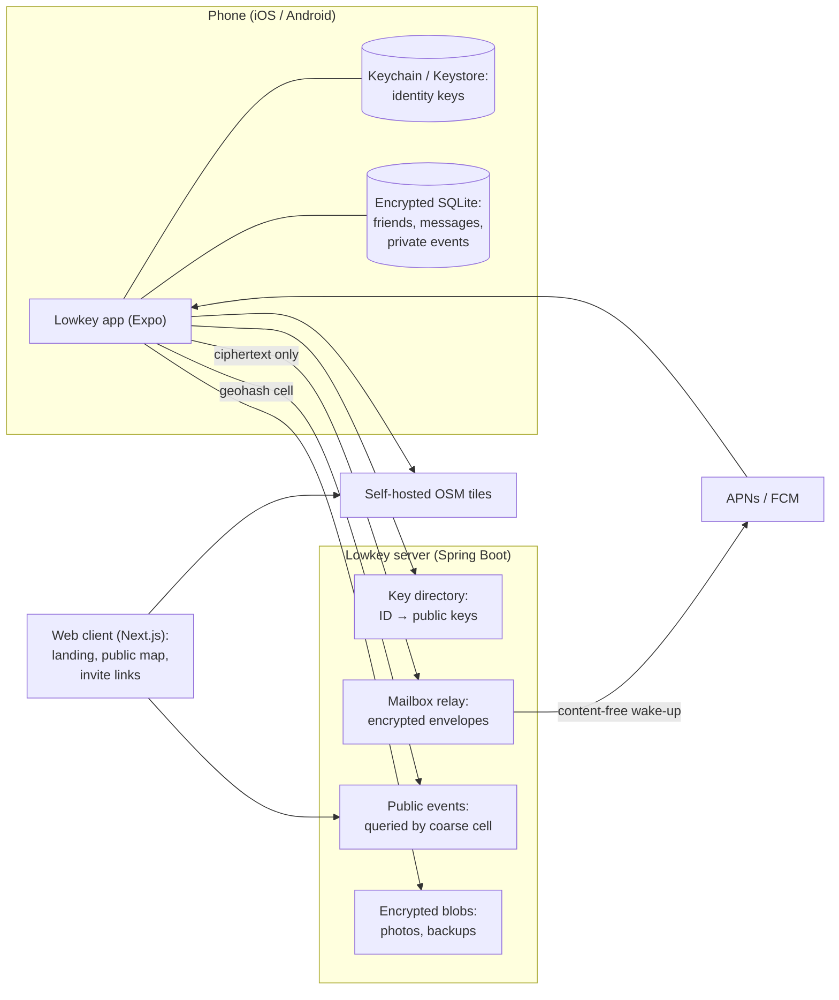

# Lowkey: privacy architecture

> Draft v0.1, 2026-09-25. Legend: ✅ decided · 🟡 proposed · ❓ open question.

Lowkey is a social app where young people create and join spontaneous events with
their friends. It is designed like a privacy-first messenger (think Threema): the server
relays and stores as little as possible, and what it stores it mostly cannot read.

## 1. Decisions so far

| | Decision |
|---|---|
| ✅ | **Mobile first, iOS and Android**, with one codebase: Expo (React Native, TypeScript). |
| ✅ | **Keep the web client** (Next.js), but give it a smaller role (see §4.8). |
| ✅ | **Keep the Spring Boot server**, but reshape it into a relay plus a minimal directory. |
| ✅ | **Solo developer for now**: prefer boring, well-documented building blocks and never invent cryptography (§4.3). |
| ✅ | **Monorepo**: `apps/client`, `apps/server`, `apps/mobile`. |

## 2. Threat model

**What we protect**
- Message, post and photo content.
- Who your friends are.
- Where you are.
- Who you are: no phone number, no email.

**Against whom**
- The Lowkey server itself: a breach, a curious operator, a legal request for data we should not have.
- Third-party SDKs: maps, geocoding, analytics, push relays.
- Other users: strangers, abusive contacts.

**Non-goals for the MVP**
- Protecting a phone that is unlocked or compromised.
- Hiding traffic patterns from a global network observer.
- Hiding routing metadata (who talks to whom, when) from our own server. This can be improved later (sealed sender, padding).

## 3. Starting point: what Spontaneo does today

| Area | Today (inherited code) | Problem |
|---|---|---|
| Accounts | Username, email and **password stored and compared in plaintext** (`UserService.java`, `.equals` on the password) | A database leak exposes every password. |
| User directory | `GET /users` returns every user, **including their email**, to any logged-in user | Anyone can harvest the whole user base. |
| Social graph | Follows stored in clear on the server | The server knows everyone's friends. |
| Events | Exact latitude and longitude stored for **all** events, private ones included | Private meeting places are readable by the server. |
| Viewing position | The map sends `lat/lng` to `/events` on every map move | The server learns where each user is looking, all the time. |
| Chat and posts | Plaintext in Postgres | The server reads every conversation and photo. |
| Maps | Mapbox tiles, Mapbox geocoding, Mapbox static images on login and register | A third party sees viewports and typed addresses. |

## 4. Target architecture

### 4.1 Identity: no phone number, no email 🟡

- On first launch, the app generates two key pairs **on the device**: Ed25519 for signing and X25519 for encryption.
- The server assigns a random **Lowkey ID** (for example `K7Q2M9XA`) and binds it to the public keys. Nothing else is needed to have an account.
- **Authentication** is a challenge and response: the server sends a nonce and the app signs it. This replaces username and password, so there is no password to leak.
- **Display name and avatar are never sent to the server in clear.** They travel to friends inside encrypted profile messages.
- **Adding a friend** happens by scanning a QR code or opening an invite link. Both contain the ID and a key fingerprint. Scanning in person marks the contact as *verified*, like Threema's trust levels (a small badge, which is also a fun social feature). There is no contact-list upload and no user search.
- One device per account in the MVP. Linked devices come later ❓.

### 4.2 Local-first storage 🟡

- **On the phone**, in SQLite encrypted with SQLCipher, with the database key kept in the Keychain or Keystore:
  - friends and their public keys;
  - profiles;
  - messages and posts;
  - private events;
  - group keys.
- **On the server**, only what is needed to route data or to reach a device that is offline (see §5).
- **Ephemeral by default** 🟡: an event, its chat and its photos expire a configurable time after the event ends (for example 30 days). This is privacy-friendly and fits the "spontaneous" spirit.

### 4.3 End-to-end encryption 🟡

- **Library:** libsodium only, through its high-level APIs: `crypto_box`, `crypto_secretbox` / XChaCha20-Poly1305, `crypto_sign`, `crypto_pwhash`. We do not write our own primitives.
- **1:1 envelopes:**
  - encrypted with `crypto_box` to the recipient's X25519 key;
  - the payload includes the sender's Ed25519 signature.
- **Event = encrypted group:**
  - The event creator generates a random 32-byte group key and sends it to each participant inside a 1:1 envelope.
  - Chat messages, posts and event details are encrypted with this key and signed by their author. The signature matters: every member holds the group key, so without it any member could impersonate another.
  - When someone leaves or is removed, the creator rotates the key.
- **Photos:**
  - re-encoded on the device, which strips EXIF data and GPS position;
  - encrypted with a fresh key and uploaded as an opaque blob;
  - the blob key travels inside the group message.
- **Later:** move to **MLS** (RFC 9420) for forward secrecy, post-compromise security and cheaper group re-keying. Until then, a stolen long-term key exposes past messages that are still stored on the server.
- **Before any public launch:** get the protocol reviewed by someone else.

### 4.4 Events and location 🟡

There are two kinds of events.

| | Public event | Friends / private event |
|---|---|---|
| Who sees it | Anyone nearby | Invited members only |
| Server knows | Title, place and time (public by nature) | An opaque group ID and encrypted envelopes |
| Shown on the map from | Server query by coarse cell | Local database |

**The user's own position never leaves the phone.**
- GPS is used on the device only: to center the map and to compute distances.
- The app asks for "while in use" permission only, never background location.

**Public events are queried by geohash cell, not by coordinates.**
- The app requests the cells that cover the viewport:
  - precision 5 is about 4.9 × 4.9 km;
  - when zoomed out, precision 4 is about 39 × 19.5 km.
- It then filters and sorts locally. The server learns roughly which area you browse, never your position.
- 🟡 Always request a fixed 3×3 block of cells, to blur further.

### 4.5 Maps and geocoding 🟡

- Replace Mapbox with **MapLibre** (native SDK on mobile, `maplibre-gl` on the web) and **OpenStreetMap tiles we host ourselves** as a Protomaps `.pmtiles` file on our own storage.
- The tile host keeps no request logs. Offline region packs come later ❓.
- **Address search** goes through a self-hosted Photon or Nominatim instance, never a third-party API.
- Replace the Mapbox static background on login and register with a local image.

### 4.6 Push notifications 🟡

- Apple (APNs) and Google (FCM) are unavoidable for background delivery. They see which device gets a push and when.
- **The server talks to APNs and FCM directly** with native device tokens (`getDevicePushTokenAsync`). We do not use the Expo push service, to avoid one more third party.
- **Payloads carry no content and no sender**: just "new activity". The app wakes up, fetches the mailbox, decrypts and shows the details locally.
- Later: an iOS Notification Service Extension to decrypt previews on the device.

### 4.7 Backup and recovery 🟡

Local-first has a cost: **lose the phone, lose everything.** Mitigation, as with Threema Safe:

- **Encrypted backup:**
  - contents: identity keys, contacts, group keys and settings (not the full history in the MVP);
  - encrypted with a key derived from a user passphrase with Argon2id (`crypto_pwhash`);
  - uploaded as an opaque blob, so the server cannot read it.
- **Enforce a strong passphrase.** Whoever steals the blob can try to guess it offline.
- **Plus a local export to a file**, for users who want nothing on the server.

### 4.8 Web client ✅ / 🟡

**Kept for:**
- the landing page;
- the public events map, read-only and without an account;
- invite-link landing pages that open the app or the store;
- later, possibly a companion session linked to the phone, like Threema Web ❓.

**Not used for holding identity keys or end-to-end chats in the MVP.** A web app is served fresh by the server on every load, so a compromised server could deliver code that steals keys. Native apps are signed and reviewed by the stores.

### 4.9 Safety and moderation 🟡

Young users plus end-to-end encryption means safety must be designed in from the start.

- **Reachability:** only people you added (QR code or invite) or who share an event with you can contact you. There is no global directory and no search by name.
- **Controls:** block, mute, and leave an event.
- **Reporting with evidence:** the reporter's app sends the offending messages together with their authors' signatures, so moderators can verify the messages are authentic without weakening encryption for anyone else.
- **Public events** are visible to the server, so they get classic moderation.
- 🟡 **No public counters**: no follower counts, like counts or public organizer ratings.
- ❓ **Minimum age.** Under the GDPR (Art. 8), consent-based processing needs a minimum age of 16 by default (13 to 16 depending on the member state). Swiss law (nLPD) sets no fixed age and relies on the capacity of discernment. Decide before any public launch, together with the app store age rating.

## 5. What the server stores (target)

| Data | Readable by server | Retention |
|---|---|---|
| Lowkey ID and public keys | yes (public by design) | account lifetime |
| Push token | yes | until it changes |
| Encrypted envelopes (chat, posts, profiles, invitations, group keys) | **no**, only routing metadata: recipient, time, size | until delivered, at most 14 days 🟡 |
| Encrypted blobs (photos) | **no** | event end + expiry window |
| Public events | yes | event end + a few days |
| Encrypted backups | **no** | until the user deletes them |
| Abuse reports | yes, only what the reporter chose to send | until handled + a short period |

**Never stored:**
- phone number or email;
- password;
- contact list;
- display names and avatars;
- GPS position;
- private events.

## 6. Mobile stack 🟡

| Concern | Choice |
|---|---|
| Framework | Expo (React Native, TypeScript), `expo-router` |
| Secrets | `expo-secure-store` (Keychain / Keystore) |
| Local database | `expo-sqlite` with SQLCipher |
| Cryptography | `react-native-libsodium` (same API as `libsodium-wrappers` on the web) |
| Map | `@maplibre/maplibre-react-native` + OpenStreetMap / Protomaps |
| Photos | `expo-image-picker` + `expo-image-manipulator` (re-encode, strips EXIF) |
| QR codes | `expo-camera` (scanning) + a QR renderer |
| Push | `expo-notifications` with native device tokens |
| Builds | Expo Go for the first UI-only steps. **Development builds** (`expo-dev-client`, Xcode / EAS Build) as soon as native modules land: libsodium, MapLibre, SQLCipher. |

The server keeps its WebSocket/STOMP infrastructure. It becomes the real-time channel
of the mailbox relay.

## 7. Open questions ❓

- **Minimum age** and app store rating (§4.9).
- **When to move to MLS** (forward secrecy), and whether to support linked devices.
- **Hosting:** today GCP `europe-west6` (Zurich). A Swiss provider would support the privacy positioning.
- **Business model:** no ads and no data resale. Options: a paid app like Threema, freemium, or grants and a non-profit.
- **Name:** check "Lowkey" for trademark and store-name availability before launch.
